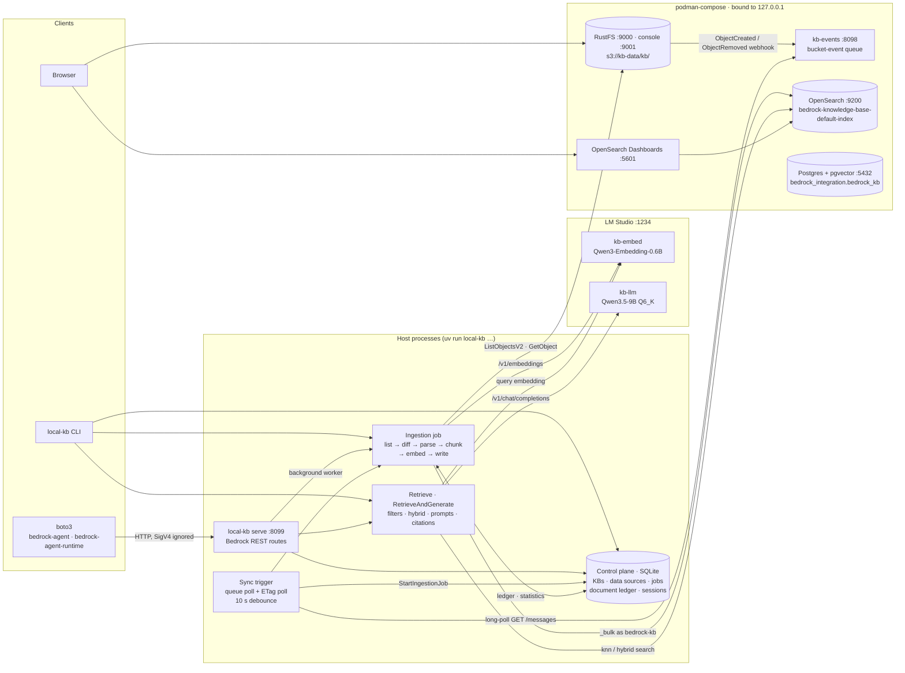
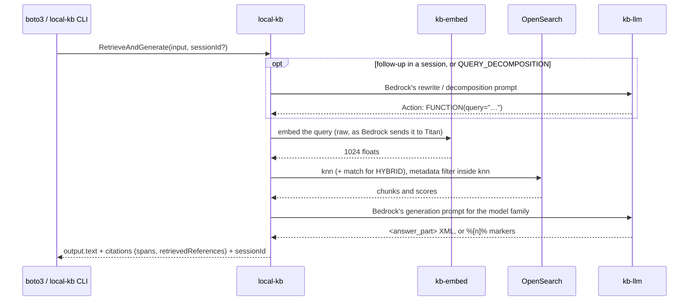

# local-kb

A local, wire-faithful re-implementation of an **Amazon Bedrock Knowledge Base**: the same
index layout, field names, ingestion counters, API shapes, prompts and citations as the cloud
[`knowledge_base`](../terraform/modules/knowledge_base/) module. It runs at $0/month instead of
~$350/month, and stock boto3 can talk to it.

"Faithful" is measured, not claimed. Phase 0 ran a real knowledge base and saved what it wrote and
returned into [`fixtures/`](fixtures/), and the 141 offline tests check the local implementation
against those fixtures. [`PLAN.md`](PLAN.md) has the design, the findings, and where the two
still differ.

**Status:** all ten phases (0–9) are done.

## Architecture



| AWS | Local stand-in |
|---|---|
| S3 data source | **RustFS 1.0.4** (bucket `kb-data`, prefix `kb/`) |
| S3 event → SQS/Lambda → `StartIngestionJob` | **kb-events** queue + the sync trigger |
| OpenSearch Serverless vector collection | **OpenSearch 3.9.0** (described to Bedrock's API as a managed cluster) |
| The collection's Dashboards | **OpenSearch Dashboards 3.9.0** |
| Titan Text Embeddings V2 (1024-d, normalized) | **Qwen3-Embedding-0.6B** in LM Studio (1024-d, normalized) |
| Claude / Nova / Llama as the generation model | **Qwen3.5-9B** in LM Studio, prompted with Bedrock's own templates |
| The `bedrock-agent` control plane | SQLite under `local-kb/.state/` |
| `bedrock-agent` + `bedrock-agent-runtime` endpoints | `local-kb serve` on `127.0.0.1:8099` |

### A question, end to end



## The apps

Everything runs on one machine. Containers are started by `make local-up`, LM Studio by
`make local-models`, and the host processes are subcommands of `local-kb`.

| App | Runs as | Address | What it does |
|---|---|---|---|
| **RustFS** | container `rustfs` | `:9000` S3 API, `:9001` console | The data source bucket. Sends a webhook for every create or delete under `kb/`. It replaces MinIO, whose images are gone ([why](PLAN.md#0-findings-that-shape-the-plan)). |
| **kb-events** | container `kb-events` ([`events/queue.py`](events/queue.py)) | `:8098` | The SQS stand-in. RustFS POSTs bucket events here, and the sync trigger long-polls `GET /messages`. It exists because RustFS refuses to call link-local addresses, which are the only route back to the host under rootless podman. |
| **OpenSearch** | container `opensearch` | `:9200` (HTTPS, self-signed) | The vector store. Security is on, and the worker uses the least-privilege `bedrock-kb` user. |
| **OpenSearch Dashboards** | container `dashboards` | `:5601` | Inspect the index the way the course video does ([below](#see-bedrocks-internal-fields-in-dashboards)). |
| **Postgres + pgvector** | container `postgres` | `:5432` | The Aurora stand-in for the `RDS` vector store, set up with AWS's own SQL (`local_init.py pg`). Being built: see [PGVECTOR_PLAN.md](PGVECTOR_PLAN.md). |
| **LM Studio** | desktop app + `lms` CLI | `:1234` (OpenAI-compatible) | Serves `kb-embed` (Qwen3-Embedding-0.6B) and `kb-llm` (Qwen3.5-9B Q6_K). |
| **`local-kb` CLI** | `uv run local-kb …` in `python/` | — | The `aws bedrock-agent` and `aws bedrock-agent-runtime` verbs, plus `sync`, `run-pending`, `watch`, `serve` and `evaluate`. |
| **`local-kb serve`** | host process | `:8099` | Bedrock's REST API for stock boto3, plus a background worker that runs ingestion jobs (and, with `--watch`, the sync trigger). |
| **`local-kb watch`** | host process | — | The sync trigger on its own: bucket events plus an ETag poll, debounced into ingestion jobs. |

### Commands

| `local-kb …` | AWS equivalent | Notes |
|---|---|---|
| `create-knowledge-base`, `get-`, `list-`, `delete-knowledge-base` | `aws bedrock-agent …` | Defaults describe the local OpenSearch and `kb-embed` |
| `create-data-source`, `get-`, `list-`, `delete-data-source` | `aws bedrock-agent …` | `--vector-ingestion-configuration` sets chunking, which is fixed at creation |
| `start-ingestion-job`, `get-`, `list-`, `stop-ingestion-job` | `aws bedrock-agent …` | Starting only queues a job; `sync`, `run-pending`, `serve` or `watch` runs it |
| `retrieve` | `aws bedrock-agent-runtime retrieve` | The `--retrieval-query text=…` shorthand works |
| `retrieve-and-generate` | `aws bedrock-agent-runtime retrieve-and-generate` | `--knowledge-base-id` shorthand, or a full `--retrieve-and-generate-configuration` |
| `sync` | the console's **Sync** button | Starts a job and runs it now |
| `run-pending` | — | Runs every queued job |
| `watch` | the S3 event → Lambda wiring | `--poll-seconds 60 --debounce 10` |
| `serve` | the Bedrock endpoints | `--port 8099 --watch` |
| `evaluate` | Bedrock's RAG evaluation | 20 questions, SEMANTIC vs HYBRID |

### Scripts and Make targets

| | What it does |
|---|---|
| `make local-up` | Writes `local-kb/.env` (random credentials), starts the containers, runs `local-init` |
| `make local-init` | [`local_init.py`](../python/scripts/local_init.py): bucket, bucket event, `bedrock-kb` user and role, Dashboards saved objects, and the Postgres schema, role and table. Idempotent. |
| `make local-smoke` | [`local_smoke.py`](../python/scripts/local_smoke.py): 8 checks on the storage behaviours sync relies on (MD5 ETags, listings, events under the prefix only), then 8 on the Postgres the RDS store needs (pgvector 0.8+, its settings, Bedrock's table checks, a write-search-rewrite-delete round trip) |
| `make local-models` | Starts LM Studio's server and loads `kb-embed` and `kb-llm` with the right flags |
| `make local-sample-docs` | Uploads [`sample-docs/kb/`](sample-docs/) to `s3://kb-data/kb/` |
| `make local-watch` | `local-kb watch` |
| `make local-serve` | `local-kb serve --watch` |
| `make local-eval KB=<id>` | `local-kb evaluate`, writing `eval/report.json` |
| `make local-psql` | psql into the local Postgres as `bedrock_user`, the role Bedrock connects as |
| `make local-corpus` | [`radio_corpus.py`](../python/scripts/radio_corpus.py): downloads the bench's radio astronomy papers and abstracts from arXiv (slow, one request per 3 s) |
| `make local-bench CORPUS=sample\|medium\|large` | `local-kb bench`: the OpenSearch and RDS stores on the same chunks and vectors; writes `bench/report-<corpus>.json` ([results](#opensearch-or-pgvector); `ISOLATE=1` measures each store alone) |
| `make local-pg-inspect [TABLE=…]` | [`pg/inspect.sql`](pg/inspect.sql): chunks per file, Bedrock's `x-amz-bedrock-kb-*` fields, sidecar attributes, vectors, indexes and sizes, search settings |
| `make local-down` / `make local-wipe` | Stop the containers / also delete their volumes (the local `terraform destroy`; delete `local-kb/.state/` too) |
| [`capture_kb_fixtures.py`](../python/scripts/capture_kb_fixtures.py) | Phase 0: records a real KB's behaviour into `fixtures/` (needs the cloud module applied) |
| [`create_vector_index.py`](../python/scripts/create_vector_index.py) | The cloud module's index-creation step (now sends the payload hash AOSS requires) |

## Quickstart

You need podman with a compose provider (`uv tool install podman-compose` if you don't have one)
and LM Studio with its `lms` CLI. The two models are a one-time download; see
[PLAN.md, Phase 2](PLAN.md#phase-2--models-in-lm-studio--done-2026-11-08).

```bash
make local-up             # containers + init
make local-smoke          # 8 PASS lines
make local-models         # LM Studio server + kb-embed + kb-llm
make local-sample-docs    # the sample corpus into s3://kb-data/kb/

cd python
uv run local-kb create-knowledge-base --name study-kb                 # note the knowledgeBaseId
uv run local-kb create-data-source --knowledge-base-id <kb> --name docs   # and the dataSourceId
uv run local-kb sync --knowledge-base-id <kb> --data-source-id <ds>   # 6 new documents, 17 chunks
uv run local-kb retrieve --knowledge-base-id <kb> --retrieval-query text=ZX-4471 \
    --retrieval-configuration '{"vectorSearchConfiguration": {"overrideSearchType": "HYBRID"}}'
uv run local-kb retrieve-and-generate --knowledge-base-id <kb> --input "text=How much is a student membership?"
uv run local-kb retrieve-and-generate --knowledge-base-id <kb> --input "text=And the orientation?" \
    --session-id <from the last answer>
```

After that, `make local-serve` keeps the knowledge base in sync. Upload or delete files through
the RustFS console at <http://127.0.0.1:9001>, and a job runs about 10 seconds after the last
change.

Credentials are in `local-kb/.env`, which is gitignored:

- Log in to Dashboards and OpenSearch as `admin` with `OPENSEARCH_INITIAL_ADMIN_PASSWORD`.
- Log in to the RustFS console with `RUSTFS_ACCESS_KEY` / `RUSTFS_SECRET_KEY`.
- The worker and server use the `bedrock-kb` user with `BEDROCK_KB_PASSWORD`, never `admin`. It
  is the local version of the AOSS data-access policy.
- Postgres: `postgres` with `POSTGRES_PASSWORD` is the superuser (Aurora's master user). The
  RDS store connects as `bedrock_user` with `BEDROCK_PG_PASSWORD`, the role AWS's guide creates.

## Use it from boto3

`make local-serve` serves both APIs on `127.0.0.1:8099`. Code written for AWS works with only
the endpoint changed:

```python
import boto3

kw = dict(endpoint_url="http://127.0.0.1:8099", region_name="us-east-1",
          aws_access_key_id="x", aws_secret_access_key="x")  # not checked
agent = boto3.client("bedrock-agent", **kw)
runtime = boto3.client("bedrock-agent-runtime", **kw)

hits = runtime.retrieve(
    knowledgeBaseId="<kb>",
    retrievalQuery={"text": "ZX-4471"},
    retrievalConfiguration={"vectorSearchConfiguration": {
        "overrideSearchType": "HYBRID",
        "filter": {"equals": {"key": "department", "value": "operations"}},
    }},
)
answer = runtime.retrieve_and_generate(
    input={"text": "How much is a student membership?"},
    retrieveAndGenerateConfiguration={
        "type": "KNOWLEDGE_BASE",
        "knowledgeBaseConfiguration": {
            "knowledgeBaseId": "<kb>",
            # The ARN picks Bedrock's prompt style (an amazon.nova-* id gets Nova's); kb-llm answers.
            "modelArn": "arn:aws:bedrock:us-east-1::foundation-model/kb-llm",
        },
    },
)
print(answer["output"]["text"], answer["citations"][0]["retrievedReferences"][0]["location"])
```

Errors come back as boto3's own `ValidationException`, `ResourceNotFoundException` and
`ConflictException`.

## See Bedrock's internal fields in Dashboards

This is the course video's demo, reproduced. `make local-init` imports
[`dashboards/bedrock-kb.ndjson`](dashboards/bedrock-kb.ndjson) into both the Private and Global
tenants:

- index pattern `bedrock-knowledge-base-default-index`, with the vector hidden from Discover;
- saved search **Bedrock KB — internals**;
- table **Chunks per source document**.

1. Open <http://127.0.0.1:5601>, log in as `admin`, and pick either tenant.
2. Open **Discover**, then **Open → Bedrock KB — internals**.
3. In the sidebar's **Search field names** box, type `x-amz-bedrock`. Only the fields Bedrock
   writes itself remain:
   - `x-amz-bedrock-kb-source-uri`, `-data-source-id` and `-source-file-modality`, each a string
     with an aggregatable `.keyword` twin;
   - `-document-page-number`, a number.
4. Type `AMAZON_BEDROCK` instead to see `AMAZON_BEDROCK_TEXT_CHUNK` and `AMAZON_BEDROCK_METADATA`.
5. Filter with KQL: `x-amz-bedrock-kb-source-uri.keyword : s3\://kb-data/kb/tidewater*`.

Things to notice:

- `_id` is the chunk-id (`1%3A0%3A…`); there is no chunk-id field.
- `AMAZON_BEDROCK_METADATA` is only `{"source": …}`.
- `.metadata.json` attributes (`department`, `revision`, `tags` …) became their own fields through
  dynamic mapping, numbers as `float`.

[`dashboards/devtools.txt`](dashboards/devtools.txt) has the same tour as Dev Tools queries.

## Evaluate it

```bash
make local-eval KB=<kb>
```

This runs [`eval/qa.jsonl`](eval/qa.jsonl), 20 questions over the sample documents. For each it
scores whether retrieval found the right file (hit@5), whether the answer contains the required
keywords, and whether an LLM judge (the local model) agrees with the reference answer. It runs
once with SEMANTIC search and once with HYBRID. Results on 2026-11-08, in
[`eval/report.json`](eval/report.json):

| Search | hit@5 | Keywords | Judge | Time per question |
|---|---|---|---|---|
| SEMANTIC | 90% | 85% | 90% | 5.1 s |
| HYBRID | 100% | 95% | 100% | 4.8 s |

**Why semantic search misses two.** Both are handbook questions ("Where is the emergency stop?",
"How long are raw frames kept?"). Default chunking makes the whole 3-page PDF one chunk covering
three topics, so its vector is a blur, and inventory chunks outrank it. It is the same failure that
made AWS miss the camera question in Phase 0. Hybrid's keyword half rescues both.

**Why keywords and judge disagree once.** The keyword check wanted "20 December", and the
answer said "December 20, 2025". It is a paraphrase, which the judge accepts.

## How faithful is it?

Matched exactly against the Phase 0 fixtures:

- **Ingestion:** all 8 counters, for a first sync and for an edit + delete + sidecar-only change.
- **Index:** the mapping, every field and type, including dynamically mapped ones.
- **Chunks:** all 17, character for character, with page numbers.
- **Responses:** Retrieve and RetrieveAndGenerate shapes, including numbers returned as floats.
- **Prompts:** all six of Bedrock's prompt templates, byte for byte.
- **Citations:** marker removal, inclusive spans, the empty-reference citation, and the "Sorry, I
  am unable to assist" fallback.
- **Filters:** the four filter fixtures.

Where it differs, on purpose or by necessity:

- **Embeddings.** Qwen is not Titan, so semantic rankings differ (top-5 overlap was 4/5 and
  9/10).
- **Hybrid search.** AWS's showed no effect at all; the local one demonstrably ranks exact codes
  first.
- **Multi-part citation spans.** Bedrock's overrun its own text; local spans are correct.
- **Not built:** `RetrieveAndGenerateStream`, `IngestKnowledgeBaseDocuments`, reranking, implicit
  filters, and the foundation-model and Data Automation parsers.

### The RDS (pgvector) store

A knowledge base with `--store rds` keeps its chunks in the local Postgres, the way Bedrock keeps
them in Aurora PostgreSQL, and runs the SQL Bedrock ran there in Phase 0b
([fixtures/rds](fixtures/rds/README.md), [PGVECTOR_PLAN.md](PGVECTOR_PLAN.md)). Two behaviours
come from AWS and are reproduced on purpose:

- **SEMANTIC results come back worst-first, scored by cosine distance** (lower is better). The
  set is the right one; Bedrock appears to sort distances as if they were similarities.
  RetrieveAndGenerate's prompt gets the same reversed list. Set `LOCAL_KB_RDS_FIX_ORDER=1` for
  best-first.
- **HYBRID is reciprocal rank fusion with `plainto_tsquery`,** which needs every word of the
  query in a chunk. An exact code like `ZX-4471` still ranks first, but a natural-language
  question rarely matches lexically, so hybrid mostly returns the vector ranking. On the
  20-question evaluation it scored 90/85/90, the same as SEMANTIC, where the OpenSearch store's
  hybrid scores 100/95/100.

To use it, give the knowledge base `--store rds` (or an RDS `storageConfiguration` from boto3).
Each RDS knowledge base needs a table of its own, as on AWS: `make local-init` creates
`bedrock_integration.bedrock_kb`, and `local_init.py pg --table bedrock_integration.<name>`
creates another. Dashboards cannot see this store; `make local-pg-inspect` shows the same
internals in psql, and `make local-psql` opens a prompt as `bedrock_user`.

### OpenSearch or pgvector?

`make local-bench CORPUS=… ISOLATE=1` loads the same chunks and vectors into both stores and
measures each one alone. The corpora are radio astronomy papers from arXiv: 232 PDFs (13,602
chunks) and 49,950 abstracts. These figures are for the 50k-abstract corpus, on a Ryzen 5 5600X:

| | OpenSearch 3.9 | Postgres 17 + pgvector 0.8.2 |
|---|---|---|
| RSS idle → loaded | 2.7 → 3.4 GB | 27 → 300 MB |
| Cold start | 13.6 s | 0.4 s |
| Images | 1.7 GB (+1.8 GB Dashboards) | 0.45 GB |
| Load through Bedrock's write path | 43 s (+81 s force merge) | 232 s (one INSERT per chunk) |
| recall@20 against exact | 0.986 | 0.964 at `ef_search` 40; 1.000 at 512 |
| SEMANTIC / HYBRID / filtered p50 | 2.2 / 7.3 / 1.6 ms | 1.7 / 5.5 / 4.2 ms |
| On disk | 496 MB | 826 MB |
| HYBRID MRR@10: 20 questions / 200 titles | 0.975 / 0.968 | 0.814 / 0.988 |

- **Pick pgvector** to keep the stack running next to a local LLM. It idles at 1% of
  OpenSearch's memory, starts in under a second, and serves unfiltered queries faster.
- **Pick OpenSearch** for hybrid search on natural-language questions. Bedrock's RDS hybrid
  uses `plainto_tsquery`, which needs every word of the query, so a question rarely matches
  lexically. OpenSearch also ingests 4–5× faster through Bedrock's write path, filters faster,
  takes less disk, and comes with Dashboards.
- On the RDS store, Bedrock's worst-first SEMANTIC order costs more than any store difference.
  Read in the order returned, MRR@10 falls from 0.93 to 0.22.

The full tables, the fusion matrix and the pros and cons are in
[PGVECTOR_PLAN.md §3 and §5](PGVECTOR_PLAN.md#5-pros-and-cons-of-running-each-locally-measured-in-p7).

## Troubleshooting

| Symptom | Cause | Fix |
|---|---|---|
| Ingestion fails with `index_create_block_exception` | OpenSearch's percentage disk watermarks tripped (85/90/95% of a big disk) | compose sets them as free space (10/5/2 GB); `make local-init` clears the leftover block |
| An answer is empty, or very slow | Qwen3.5 is "thinking" | Every request must send `reasoning_effort: "none"`. `generate.py` does; `enable_thinking` is ignored |
| No bucket events arrive | RustFS refuses link-local webhook targets | Events go to the `kb-events` container instead; check `podman logs local-kb_kb-events_1` |
| `403` as `bedrock-kb` | The least-privilege role lacks that action | Mapping reads and similar are admin-only by design; use `admin` for inspection |
| The cloud module's `create_vector_index.py` gets `403` | AOSS rejects signed bodies without `x-amz-content-sha256` | Fixed in the script |

## Files

```
local-kb/
  README.md            this guide
  PLAN.md              design, Phase 0 findings, phase-by-phase results
  compose.yaml         rustfs, kb-events, opensearch, dashboards, postgres
  .env.example         the credentials local_init.py generates into .env
  events/queue.py      kb-events, the bucket-event queue
  dashboards/          saved objects + Dev Tools queries
  pg/inspect.sql       the RDS store's internals in psql (the Dashboards view's counterpart)
  bench/               radio-papers.tsv (the medium corpus's arXiv ids) + report-<corpus>.json
  eval/                qa.jsonl (20 questions) + report.json
  fixtures/            what a real Bedrock KB wrote and returned (Phase 0; rds/ for Aurora)
  sample-docs/         the corpus used by Phase 0, the tests, and the evaluation
python/src/aws_ai/local_kb/
  cli.py               the local-kb command
  server.py            Bedrock's REST routes (FastAPI)
  control.py           the control plane (SQLite)
  ingest.py            the ingestion job and its counters
  parse.py, chunking.py, embed.py
  store.py             the vector-store seam: StoredChunk, Hit, store_for()
  store_opensearch.py  the OpenSearch store: layout, k-NN, hybrid pipeline, result shape
  store_rds.py         the RDS (pgvector) store: Bedrock's SQL, captured on Aurora
  index.py, opensearch.py   OpenSearch index body and client
  filters.py           RetrievalFilter → OpenSearch query, and → SQL for the RDS store
  trigger.py           queue + ETag poll → ingestion jobs
  retrieve.py          Retrieve: validation, embedding, HIERARCHICAL collapse
  generate.py, prompts/   RetrieveAndGenerate and Bedrock's six prompt templates
  evaluate.py          the evaluation harness
  bench.py, bench_resources.py   local-kb bench: OpenSearch vs pgvector, and what each costs
```
